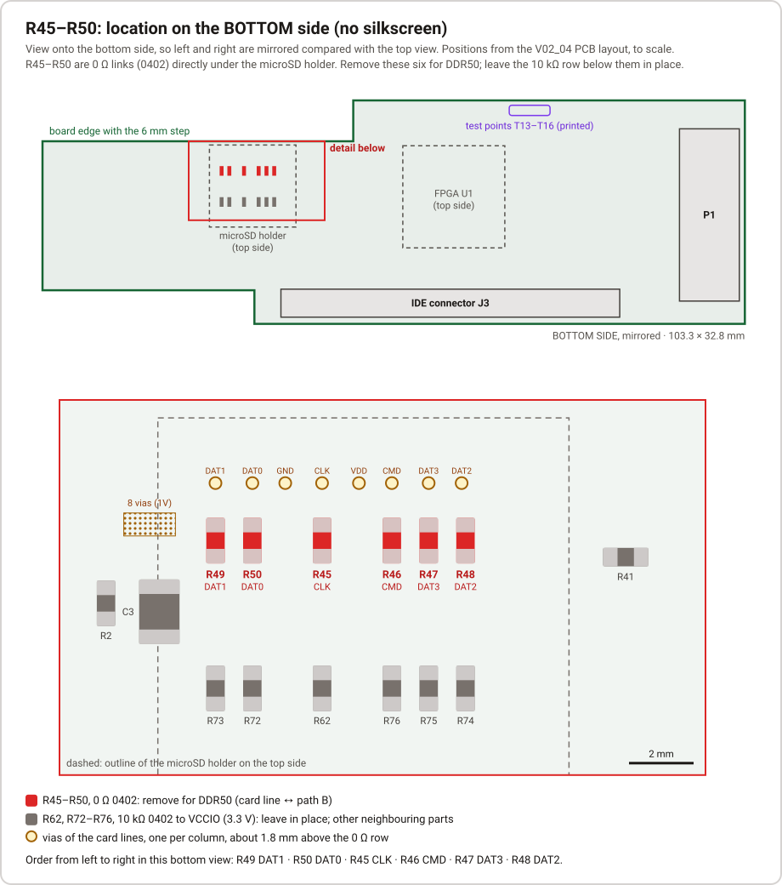

# Board modification for DDR50: removing R45–R50

UHS-I DDR50 (psx2 and later) is only stable after six 0 Ω resistors, R45–R50, have been removed. Without the
modification the firmware detects the read errors and falls back to 50 MHz SDR at 1.8 V; data stays correct,
reads are slower (see [STATUS.md](STATUS.md), H5e/H5f, and [UHS.md](UHS.md)).

## What R45–R50 do

The microSD card lines are wired to the FPGA twice:

- **Path A** through the NVT4857 level translator U9 (FPGA nets `SDIO_*`, 1.8 V or 3.3 V on the card side).
  The firmware always uses this path.
- **Path B** directly to FPGA bank 35 at 3.3 V (called `SD_DIRECT_*` in the firmware, nets `U1_xx` in the
  schematic). Each line of path B has a 10 kΩ pull-up to VCCIO (3.3 V).

R45–R50 are the 0 Ω links that connect the card lines to path B:

| Card line | microSD pin | 0 Ω link | FPGA ball (path B) | 10 kΩ pull-up to VCCIO |
|---|---|---|---|---|
| CLK | 5 | **R45** | H2 | R62 |
| CMD | 3 | **R46** | J2 | R76 |
| DAT3 | 2 | **R47** | J3 | R75 |
| DAT2 | 1 | **R48** | J4 | R74 |
| DAT1 | 8 | **R49** | G1 | R73 |
| DAT0 | 7 | **R50** | H1 | R72 |

While R45–R50 are fitted, the six 10 kΩ pull-ups pull the card lines towards 3.3 V, also in 1.8 V UHS-I
mode, which is outside the SD specification. With them, the DDR50 data eye was narrow and drifted (H5e).
Removing the six links disconnects path B and its pull-ups from the card; afterwards the card lines are
connected only to the NVT4857, and DDR50 ran 1 GB without a single retry (H5f).

**Consequence:** path B (build target `m2b`) no longer reaches the card. No release uses path B.
Re-fitting six 0 Ω 0402 links (or solder bridges) restores the original state.

## Where they are

- **Bottom side**, directly underneath the microSD holder; the board has no silkscreen for them.
- Six 0402 parts in one row, mounted vertically (long axis across the board), at the same height as the
  card-line vias.
- About 4.6 mm below them is a second row of six 0402 parts in exactly the same columns: the 10 kΩ pull-ups
  R62 and R72–R76. **Leave that row in place.** Removing the pull-ups instead of the links would leave path B
  connected to the card.
- Above the 0 Ω row there is a row of eight vias, one per column (card lines plus card VDD and GND).
- Seen from the bottom with P1 on the right and the IDE connector at the bottom edge, the order from left to
  right is R49 (DAT1), R50 (DAT0), gap, R45 (CLK), gap, R46 (CMD), R47 (DAT3), R48 (DAT2).

Positions come from the V02_04 PCB layout (component centres; R45–R50 at y = 10.35 mm, the pull-ups at
y = 14.92 mm from the upper board edge). The drawing is to scale but has not been compared with a photo of
a real board. Check the two rows with a magnifier before you heat anything. A 0 Ω link shows 0 Ω when
measured in circuit; a 10 kΩ pull-up shows roughly 10 kΩ when measured in circuit, depending on what else is
connected.

## Checking the result

After the modification, run psx2 or later on a PC (see the release README) and read a few hundred MB.
`python scripts/jtag_trace.py --status` should show DDR50 active and no SD retries.
