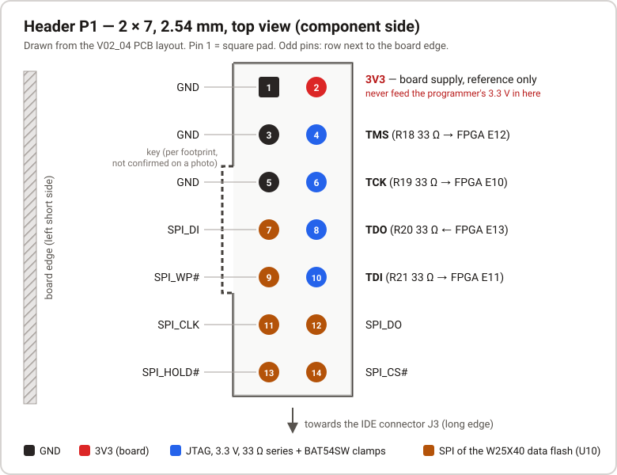
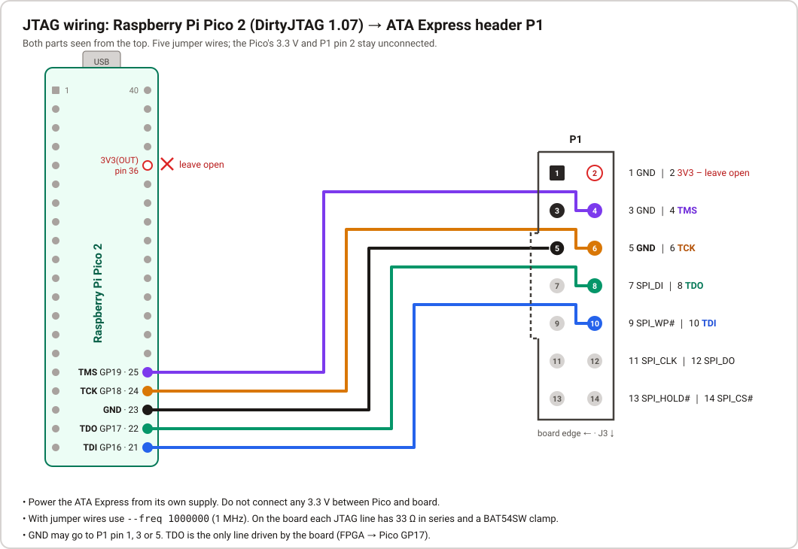

# JTAG header P1 and the Pico programmer

How to connect a Raspberry Pi Pico 2 running DirtyJTAG to the ATA Express, and what else is on header P1.
Everything here was taken from the V02_04 PCB layout (EasyEDA) and from the maintainer's working bench
setup. Items marked *unknown* or *not confirmed* have not been checked.

## Header P1



| Property | Value |
|---|---|
| Type | Shrouded box header 2 × 7, 14 pins, 2.54 mm pitch, vertical, through-hole (footprint `IDC-TH_14P-P2.54-V-R2-C7-S2.54`) |
| Location | Left short side of the board, about 5 mm from the edge, roughly centred. R18–R21 and D1–D4 sit right next to it; the FPGA is about 37 mm further in. The microSD slot and the regulators are at the opposite end, the IDE connector J3 along a long edge |
| Pin 1 | Square pad. Odd pins (1, 3 … 13) form the row next to the board edge, even pins the inner row. Pins 1/2 are at the end facing away from J3, pins 13/14 at the end towards J3 |
| Key | On the odd (board edge) side, centred around pins 5–9 according to the footprint. *Not confirmed on a photo* |
| Levels | 3.3 V |

| Pin | Net | Connects to | Pin | Net | Connects to |
|---|---|---|---|---|---|
| 1 | GND | | 2 | 3V3 | Board 3.3 V supply. Reference only, see below |
| 3 | GND | | 4 | TMS | R18 33 Ω → FPGA ball E12 |
| 5 | GND | | 6 | TCK | R19 33 Ω → FPGA ball E10 |
| 7 | SPI_DI | W25X40 pin 5 (DI), FPGA ball E3 | 8 | TDO | R20 33 Ω ← FPGA ball E13 |
| 9 | SPI_WP | W25X40 pin 3 (/WP), FPGA ball E2 | 10 | TDI | R21 33 Ω → FPGA ball E11 |
| 11 | SPI_CLK | W25X40 pin 6 (CLK), FPGA ball E1 | 12 | SPI_DO | W25X40 pin 2 (DO), FPGA ball D3 |
| 13 | SPI_HOLD | W25X40 pin 7 (/HOLD), FPGA ball D2 | 14 | SPI_CS | W25X40 pin 1 (/CS), FPGA ball C1 |

Pins 1–10 follow the usual Xilinx JTAG header assignment (2 = VREF, 4/6/8/10 = TMS/TCK/TDO/TDI, odd = GND).
Pins 7 and 9–14 belong to the SPI bus of the W25X40 data flash (U10).

**Protection.** Each JTAG line has a 33 Ω series resistor (0402) and, on the FPGA side of it, a BAT54SW dual
diode to 3V3 and GND (D1 TMS, D2 TCK, D3 TDO, D4 TDI). The SPI lines have no series resistors, clamps or
pull-ups on the board.

**Pin 2 (3V3).** This is the board's own 3.3 V rail when the board is powered. Use it at most as a voltage
reference. Never connect the programmer's 3.3 V to it: the board powers itself, and what back-feeding
into this rail would do has not been examined (*unknown*). On the bench the maintainer powers the board
from a 5 V supply.

**The configuration flash is not on P1.** P1 only reaches the W25X40 (512 KiB data flash with the HDD ID,
see [SCE.md](SCE.md)). The 16 MiB N25Q128 configuration flash (U8) is written through JTAG with the
openFPGALoader SPI bridge, see [FLASH.md](FLASH.md).

**Programming the W25X40 externally through P1.** The firmware keeps all SPI pins high-impedance while it
is not accessing the flash itself (at startup for about 0.2 ms, and during the WRITE ID command; see
[INTERFACES.md](INTERFACES.md)). The W25X40 is powered from VCCIO, a 3.3 V LDO output (U7 SPX3819-3.3,
enabled by 3V3; not measured). External programming through P1 has *not been tried*. Do not change the
HDD ID of a card that a PSX has already formatted (see [SCE.md](SCE.md) and the README).

## Wiring the Pico 2



| Signal | Pico 2 GPIO | Pico 2 pin | P1 pin | Driven by |
|---|---|---|---|---|
| TMS | GP19 | 25 | 4 | Pico |
| TCK | GP18 | 24 | 6 | Pico |
| TDO | GP17 | 22 | 8 | FPGA |
| TDI | GP16 | 21 | 10 | Pico |
| GND | — | 23 | 1, 3 or 5 | — |
| 3.3 V | — | (36, 3V3(OUT)) | (2) | **not connected** |

GP20 (RST) and GP21 (TRST) of DirtyJTAG are not used. Plain female-female jumper wires work; cable length
of the maintainer's setup is *unknown*, keep them short.

### Programmer firmware: building DirtyJTAG for the Pico 2

The maintainer uses a **Raspberry Pi Pico 2 (RP2350)** with **DirtyJTAG 1.07** from
[phdussud/pico-dirtyJtag](https://github.com/phdussud/pico-dirtyJtag) (MIT license), tag `V1.07`,
commit `533ad9a23231cf7a95138a30cdcc0c67758bd423`, source unmodified. Neither the source nor a binary is
included in this repository; build it yourself.

**Why build it:** the V1.07 release (2025-07-29) ships a single `dirtyJtag.uf2` (87 040 bytes) plus the
`.elf`. The upstream README does not mention the RP2350 or the Pico 2, and the source defaults to
`PICO_BOARD=pico` (RP2040, `CMakeLists.txt` line 40). The released UF2 is therefore most likely for the
RP2040 only (its UF2 family ID has not been checked).

**Build** (tools used by the maintainer: pico-sdk 2.3.1, Arm GNU Toolchain 14.3.Rel1 /
`arm-none-eabi-gcc` 14.3.1):

```bash
git clone --branch V1.07 https://github.com/phdussud/pico-dirtyJtag.git
cd pico-dirtyJtag
cmake -B build -DPICO_BOARD=pico2 -DPICO_PLATFORM=rp2350-arm-s -DCMAKE_BUILD_TYPE=Release -DPICO_SDK_PATH=<path-to-pico-sdk>
cmake --build build
```

The result is `build/dirtyJtag.uf2`. Hold BOOTSEL while plugging in the Pico 2 and copy the file to the
drive that appears. The pin assignment is the source default for `BOARD_PICO` (`dirtyJtagConfig.h`
lines 65–70): TDI GP16, TDO GP17, TCK GP18, TMS GP19; RST GP20 and TRST GP21 are unused.

For reference only: the maintainer's build is 54 784 bytes with SHA-256
`5db5ce3819fd1704d422d62c0e8d191e39fd98a268d3effc2a1876eee752a8ba`. Whether a rebuild is byte-identical
has not been checked, so this is not a verification value.

An original Pico (RP2040) with the upstream UF2 has not been tested with this board.

The Pico enumerates as USB `1209:C0CA` with three interfaces. **Windows:** run Zadig, enable
*Options → List All Devices*, select **"DirtyJTAG (Interface 0)"** (`1209 C0CA`, MI 00) and install **WinUSB**.
Leave interfaces 1 and 3 (serial ports) alone. **Linux:** no driver needed; access to the USB device may
require a udev rule or running as root.

### openFPGALoader

Tested with openFPGALoader v1.1.1 (the MSYS2 CI build from the GitHub release, on Windows).

```powershell
$ofl = "<path-to>\openFPGALoader.exe"
& $ofl -c dirtyJtag --freq 1000000 --detect
```

- Expected: `xc7a100t`. The maintainer's board reports IDCODE `0x13631093` (device revision 1; other boards
  may report another revision in the top four bits).
- **Always pass `--freq 1000000`** (1 MHz) with jumper wires. With the default 6 MHz openFPGALoader reports
  "TDO is stuck at 0".
- Flash access needs `--bridge <path-to>\spiOverJtag_xc7a100tcsg324.bit`. It ships gzipped with
  openFPGALoader (`share/openFPGALoader/spiOverJtag_xc7a100tcsg324.bit.gz`); unpack it first.
- The MSYS2 build of openFPGALoader calls `cygpath` when flashing, even with `--bridge`. In PowerShell put
  MSYS2's `usr\bin` in front of the path first: `$env:Path = "C:\msys64\usr\bin;" + $env:Path`.
- First thing after `--detect`: dump the original flash ([FLASH.md](FLASH.md) §7.1).

The same Pico is used by `scripts/jtag_trace.py` for the ATA bus trace (USER1). It talks to DirtyJTAG
directly through libusb and does not disturb the ATA side, so it can run while the board is in use.

## Other programmers

| Programmer | Loading and flashing (openFPGALoader) | Bus trace and debug tools (`jtag_trace.py`, `re_check.py`, `ddr_cap.py`) |
|---|---|---|
| Pico 2 (RP2350) with DirtyJTAG 1.07 | tested | tested |
| Pico (RP2040) with DirtyJTAG | expected to work, untested | expected to work, untested |
| Other JTAG cables supported by openFPGALoader (e.g. FT2232H/FT232H-based) | expected to work, untested; use `-c <cable>` instead of `-c dirtyJtag` | not supported |

- The debug tools do not go through openFPGALoader. They speak the DirtyJTAG USB protocol directly
  (`1209:C0CA`, via libusb), so they need a DirtyJTAG programmer.
- For an RP2040 Pico, build DirtyJTAG with `-DPICO_BOARD=pico`, which is the upstream default, or use the
  release UF2. The `BOARD_PICO` pin assignment is the same as on the Pico 2, so the wiring above applies.
- Any cable must work at 3.3 V. Connect GND and the four signals as in the P1 table. If the cable needs a
  target reference voltage (VREF), P1 pin 2 can serve as the reference. Never let the cable supply power into
  pin 2.
- `scripts/bench.sh load` uses the cable given in `$OFL_CABLE` (default `dirtyJtag`).
- Run `openFPGALoader --list-cables` for the list of supported cables.

## Open points

- Key position on the real part, and how P1 is reached with the board installed in a PSX: *unknown*.
- Which switching regulator (U3/U4/U5, ETA1471) supplies the 3V3 rail: not traced.
- External programming of the W25X40 through P1: not tried.
